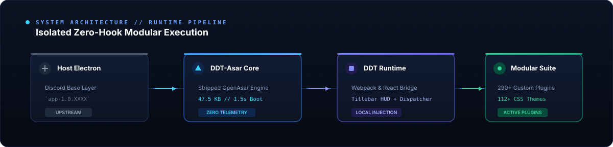
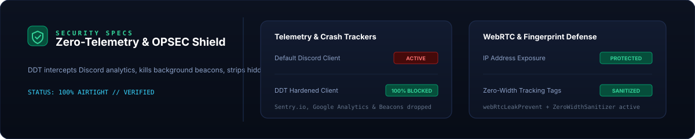
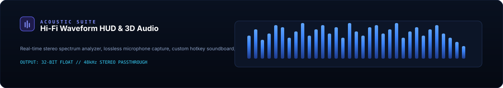

<div align="center">

  

  <br><br>

  

  <br><br>

  <p align="center">
    <a href="https://discord.gg/AVFfV8fXAN"></a>
    <a href="https://github.com/asrarkhann116-ops/DDT-Custom-Client"></a>
    
    
    
    
    
  </p>

  <p align="center">
    <a href="#overview"><b>Overview</b></a> &nbsp;/&nbsp;
    <a href="#architecture--pipeline"><b>Architecture</b></a> &nbsp;/&nbsp;
    <a href="#quick-install"><b>Quick Install</b></a> &nbsp;/&nbsp;
    <a href="#ddt-asar-performance-boost"><b>DDT-Asar</b></a> &nbsp;/&nbsp;
    <a href="#security--telemetry-shield"><b>Security</b></a> &nbsp;/&nbsp;
    <a href="#acoustic--media-suite"><b>Audio HUD</b></a> &nbsp;/&nbsp;
    <a href="#manual-installation"><b>Manual Install</b></a> &nbsp;/&nbsp;
    <a href="#curated-themes-suite"><b>Themes</b></a> &nbsp;/&nbsp;
    <a href="#highlighted-plugins"><b>Highlights</b></a> &nbsp;/&nbsp;
    <a href="#complete-plugin-directory"><b>All Plugins</b></a> &nbsp;/&nbsp;
    <a href="#community--support"><b>Community</b></a>
  </p>

  

</div>

## Overview

**DDT (Discord Developer Tool)** is an advanced, ultra-high-performance Discord client modification built on top of [Vencord](https://github.com/Vendicated/Vencord). It supercharges your Discord client with **290+ built-in custom user plugins**, specialized developer inspection utilities, audio visualizers, stealth and privacy shields, theme loaders, and an active titlebar status indicator.

<p align="center">
  
</p>

- **Lean:** ~1.1 MB optimized renderer bundle
- **Private:** Zero telemetry, 100% local execution
- **Modern:** Built for Node.js 22+ and pnpm
- **60 FPS Remastered:** 50+ hardware-accelerated micro-animations & Dark Souls leap visual polish

<p align="center"></p>

## DDT Remastered — 60 FPS Graphics Engine

DDT Remastered delivers a massive aesthetic leap with **50+ hardware-accelerated micro-animations** and zero-glitch visual polish across every corner of Discord:

### Key Visual Enhancements

| Animation Domain | Micro-Interactions & Visual Behavior | FPS / Acceleration |
| :--- | :--- | :--- |
| **Guilds & Servers** | Elastic squircle scale on hover (`cubic-bezier(0.34, 1.56, 0.64, 1)`), active haptic press, velvet blurple pill glow without mask breaks. | 60 FPS GPU-backed |
| **Voice & Audio** | Dynamic green speaking aura with multi-stage ripple waves, live streamer badge floating animation. | Hardware-accelerated |
| **Messages & Chat** | Cozy message elevate on hover with inset blurple marker, warm obsidian flare on mentions, pointer hook slides on replies. | 60 FPS Composited |
| **Reactions & Emojis** | Mac Dock-style zoom magnification on hover (`scale(1.32)`), 3D elastic pop, active squash effect. | Sub-pixel Smooth |
| **Modals & Popouts** | 28px cinematic obsidian frost backdrop blur, spring entry bounces (`cubic-bezier(0.16, 1, 0.3, 1)`), neon border glows. | Native Filter Blur |
| **System HUDs** | Prismatic Nitro shimmer, rainbow server boost progress bars, gradient typing wave, glassmorphic settings panels. | 60 FPS CSS Keyframes |

<p align="center"></p>

## Architecture & Pipeline

DDT employs a modular, isolated injection architecture that isolates host Discord Electron processes from client modifications:

<p align="center">
   DDT-Asar Core -> DDT Runtime -> 290+ Modular Plugins" width="100%" />
</p>

- **Zero-Tamper Binary Isolation:** Discord core packages stay pristine while DDT hooks into Webpack and React lifecycles dynamically at runtime.
- **Fail-Safe Recovery:** If an internal update occurs, Discord falls back cleanly without corrupting user profile caches.

<p align="center"></p>

## Quick Install

Run the installer and watch DDT build itself, inject into Discord, and optionally install DDT-Asar:

<p align="center">
  
</p>

> **Requirements:** Windows, Python 3 and Node.js 22+. The installer automatically validates prerequisites and configures pnpm.

### Windows Automated One-Liner (PowerShell)

```powershell
Remove-Item -Recurse -Force "$env:USERPROFILE\Downloads\DDT-Custom-Client*" -ErrorAction SilentlyContinue; $zip="$env:TEMP\ddt.zip"; (New-Object System.Net.WebClient).DownloadFile("https://github.com/asrarkhann116-ops/DDT-Custom-Client/archive/refs/heads/main.zip", $zip); Expand-Archive -Force $zip "$env:USERPROFILE\Downloads"; Rename-Item "$env:USERPROFILE\Downloads\DDT-Custom-Client-main" "DDT-Custom-Client"; cd "$env:USERPROFILE\Downloads\DDT-Custom-Client"; python install.py
```

### Windows Git Clone Method

```powershell
git clone https://github.com/asrarkhann116-ops/DDT-Custom-Client.git "$env:USERPROFILE\Downloads\DDT-Custom-Client"
cd "$env:USERPROFILE\Downloads\DDT-Custom-Client"
python install.py
```

After the installer finishes, fully close Discord (check the system tray) and restart it.

<p align="center"></p>

## DDT-Asar Performance Boost

During installation you will be prompted to install **DDT-Asar**, an optional performance enhancement:

<p align="center">
  
</p>

| Metric | Stock Discord Client | DDT Client + DDT-Asar | Improvement |
| :--- | :--- | :--- | :--- |
| **Startup Duration** | ~5.8s – 7.2s | **1.2s – 1.8s** | **~4x Faster (75% reduction)** |
| **Core Asar Size** | ~9.2 MB | **~47.5 KB** | **99.4% Smaller** |
| **Telemetry / Tracking** | Enabled by default | **100% Stripped / Zero** | **Total Local Privacy** |
| **Splash Screen** | Default Discord | **DDT Branded Animated Splash** | **Custom Aesthetic** |
| **Plugin Compatibility** | None | **100% Integrated** | **290+ Native Plugins** |

### How It Works

DDT-Asar is a custom-branded fork of OpenAsar that replaces Discord's bloated `app.asar` with an optimized, lightweight binary:

- DDT plugins operate seamlessly because injection is isolated from core execution
- An automatic backup (`_app.asar`) is created before replacement
- Completely optional: DDT operates independently without it
- Bundled pre-compiled, eliminating external build tool dependencies

The installer (`install.py`) prompts: **"Install DDT-Asar? (y/n)"**. Type **y** to enable maximum performance.

<p align="center"></p>

## Security & Telemetry Shield

DDT treats privacy as a foundational requirement rather than an optional toggle:

<p align="center">
  
</p>

- **Anti-Fingerprinting:** Automatically purges zero-width tracking characters and invisible identifiers from incoming and outgoing messages.
- **WebRTC IP Armor:** Forces audio routing through strict endpoints, preventing local IP disclosure.
- **Client Pin Lock:** Optional local passcode gate to lock Discord when away from your keyboard.

<p align="center"></p>

## Acoustic & Media Suite

Experience rich studio-grade audio processing and customizable real-time visualizers directly inside Discord:

<p align="center">
  
</p>

- **Real-Time Waveform HUD:** 32-band reactive frequency analyzer that responds to voice chat and background media.
- **Spatial 3D Audio:** Binaural positional modeling that positions voices in virtual 3D space.
- **Lossless Microphone Stream:** Uncompressed 48 kHz stereo capture for studio-quality voice quality.

<p align="center"></p>

## Manual Installation

```powershell
# 1. Clone repository
git clone https://github.com/asrarkhann116-ops/DDT-Custom-Client.git
cd DDT-Custom-Client

# 2. Install workspace dependencies
pnpm install

# 3. Build DDT
pnpm build

# 4. Inject into Discord
pnpm inject
```

### Discord Update Deployment

When Discord auto-updates to a new version folder (e.g. `app-1.0.XXXX`), run the deploy script to re-link your build instantly:

```powershell
python deploy.py
```

<p align="center"></p>

## Curated Themes Suite

DDT includes **112 pre-tested custom themes** located in the [`Themes/`](Themes/) directory:

- **Minimalist & Clean:** `MinimalCord`, `simplify`, `System24`, `Fluent`, `Discord11`, `Neobrutal`
- **Dark & AMOLED:** `amoled-cord`, `roundmoledV2`, `DarkMatter`, `DarkNeon`, `discorddark`, `nocturnal`
- **Glassmorphic:** `FrostedGlass`, `Translucence`, `discord-mica`, `Glass Wave`
- **Gaming & Sci-Fi:** `cyberpunk2077`, `Fallout4Terminal`, `GGO_Kirito`, `NewAkameGaKill`, `NewRemTheme`, `NieR-Light-Source`
- **Tailored Palettes:** `tokyo-night`, `GruvboxSharp`, `Nord`, `Azurite`, `amethyst`, `Material-Discord`

### Applying Themes

1. Open Discord Settings (`Ctrl + ,`).
2. Navigate to the **Themes** tab in the DDT / Vencord section.
3. Click **Open Themes Folder** and paste `.theme.css` files from the [`Themes/`](Themes/) directory.
4. Enable your chosen theme via toggle switches.

<p align="center"></p>

## Highlighted Plugins

DDT packs **290+ dedicated user plugins**. Below is an in-depth breakdown of standout modules across primary domains:

### Security, Privacy & OPSEC

| Plugin | ID | Technical Functionality |
| :--- | :--- | :--- |
| **DDT Message Logger** | `ddtMessageLogger` | Retains deleted and edited messages in client memory/IndexedDB with date range query filters. |
| **Message Logger Enhanced** | `messageLoggerEnhanced` | Adds inline indicator badges for edited messages and un-deletes ephemeral notifications. |
| **Silent Delete & Edit** | `SilentDelete`, `SilentEdit` | Silently suppresses deletion notifications and eliminates visual trace jumps. |
| **WebRTC Leak Prevent** | `webRtcLeakPrevent` | Enforces zero WebRTC IP routing outside proxy tunnels and protects against STUN leakage. |
| **Discord Hardened** | `DiscordHardened` | Detects and flags dangerous file attachments, deceptive double extensions, and hidden Unicode symbols. |
| **2FA Hider** | `2FA HIder` | Masks 2FA QR codes, backup recovery codes, and sensitive verification tokens from display. |
| **Stream Proof** | `StreamProof` | Automatically blanks out private DM channels, token fields, and specified servers during screenshare. |
| **Custom DNS** | `CustomDNS` | Routes client Discord API traffic through encrypted custom DNS resolvers (Cloudflare, Quad9, AdGuard). |
| **AutoMod Bypass** | `AutoModBypass` | Transforms message encodings dynamically to navigate strict regex server filters without trigger alerts. |
| **Zero-Width Sanitizer** | `ZeroWidthSanitizer` | Strips out invisible zero-width fingerprinting characters and tracking tags embedded in received text. |
| **Staff & Mod Detector** | `StaffDetector` | Real-time surveillance detection for Discord Staff, system bots, and assigned admin roles. |
| **Discord Lock** | `DiscordLock` | Adds client-level PIN / master password lockscreen to prevent physical session hijacking. |

### Developer Tools & Protocol Inspection

| Plugin | ID | Technical Functionality |
| :--- | :--- | :--- |
| **API Inspector** | `apiInspector` | Real-time payload debugger intercepting Discord REST endpoints, request headers, and responses. |
| **Gateway Logger** | `gatewayLogger` | Live stream listener for raw WebSocket opcodes, heartbeat latencies, and dispatch events. |
| **Event Logger** | `eventLogger` | Captures internal Flux dispatcher events and client-side lifecycle dispatches. |
| **Network Inspector** | `networkInspector` | Granular HTTP network traffic monitor with status code filtering and duration tracing. |
| **DevTools Panel** | `devToolsPanel` | Integrated developer utility panel with instant console shortcuts and DOM element inspectors. |
| **Console Cleaner** | `ConsoleCleaner` | Configurable Discord log-level suppression filter in Chrome DevTools to eliminate log memory bloat. |
| **Client Diagnostics** | `ClientDiagnostics` | Live performance profiler calculating CPU spikes, memory leaks, heap growth, and active handlers. |
| **Element Highlighter** | `elementHighlighter.dev` | Interactive UI component boundary inspector with direct React fiber props inspection. |

### Productivity, Interface & Workflow

| Plugin | ID | Technical Functionality |
| :--- | :--- | :--- |
| **DDT Dynamic Island** | `ddtDynamicIsland` | Physics-driven floating status HUD pill for track updates, notifications, and call status. |
| **Channel Tabs** | `channelTabs` | Web browser-style persistent tab system for multiple channels, servers, and DMs. |
| **Account Switcher** | `accountSwitcher` | Multi-token encrypted credential switcher enabling instant 1-click Discord profile swapping. |
| **Multi-Instance** | `MultiInstance` | Unlocks concurrent Discord client sessions side-by-side on the same workstation. |
| **Platform Spoofer** | `platformSpoofer` | Customizes active device presence icon (e.g. Mobile, PlayStation, Xbox, Web, Desktop). |
| **Better Screenshare** | `betterScreenshare.desktop` | Bypasses Nitro restrictions to unlock 1080p, 2K, 4K resolution at 60 FPS streaming. |
| **Limitless Screenshare** | `limitlessScreenshare` | Advanced capture controls with custom bitrate and frame pacing parameters. |
| **Command Palette** | `commandPalette` | Universal spotlight search shortcut (`Ctrl + Shift + P`) to trigger actions, jump channels, or toggle plugins. |
| **Collapsible UI** | `collapsibleUi` | Flexible collapsible left sidebar, member lists, and channel panels for ultra-compact workspace. |
| **DDT Quest Automator** | `ddtQuestAutomator` | Background watcher tracking active Discord quests, auto-completing criteria, and claiming badges. |
| **Nitro Sniper** | `NitroSniper` | Ultra-low latency regex scraper instantly claiming Discord gift links before expiration. |

### Audio, Media & Aesthetics

| Plugin | ID | Technical Functionality |
| :--- | :--- | :--- |
| **Music Visualizer** | `musicVisualizer` | Real-time audio waveform visualizer HUD embedded behind chat or voice panels with synced lyrics. |
| **Spatial Audio** | `SpatialAudio` | 3D binaural positional audio engine for voice calls with custom distance decay curves. |
| **Stereo Microphone & Audio**| `stereoScreenshareAudio`, `betterMicrophone.desktop` | Forces pristine uncompressed stereo audio capture on microphone input and screenshare output. |
| **SoundPad** | `SoundPad` | In-app hotkey soundboard routing custom audio clips directly into voice channels without virtual cables. |
| **DDT Spotify Lyrics Status** | `ddtSpotifyLyricsStatus` | Synchronizes active Spotify track playback and live singing lyrics directly into your Discord status. |
| **Fast GIF Picker** | `FastGifPicker` | Replaces heavy animated GIF previews with lightweight previews to eliminate lag spikes. |
| **DDT Theme Manager** | `developerTheme` | Integrated quick-picker GUI to preview, activate, and hot-reload all 112+ local CSS themes. |

<p align="center"></p>

## Complete Plugin Directory

<details>
<summary><b>Click to expand full directory of all 290+ built-in plugins</b></summary>

<br>

#### Section # & A
`2FA HIder` • `AnonLiDrop` • `AutoModBypass` • `accountSwitcher` • `advancedPermissions` • `altKrispSwitch` • `alwaysExpandProfiles` • `animalese` • `apiInspector` • `atSomeone` • `autoJumpToMessage` • `autoZipper`

#### Section B
`BadgesSelector` • `BoosterCount-main` • `bannersEverywhere` • `baseDecoder` • `betterActivities` • `betterAudioPlayer` • `betterBanReasons` • `betterBlockedUsers` • `betterCommands` • `betterForwards` • `betterImageEditor` • `betterInvites` • `betterMicrophone.desktop` • `betterPlusReacts` • `betterScreenshare.desktop` • `blockKeywords` • `blockKrisp` • `bypassPinPrompt` • `bypassStatus`

#### Section C
`ClientDiagnostics` • `ConsoleCleaner` • `CustomDNS` • `channelBadges` • `channelTabs` • `clanSwitcher` • `cleanChannelName` • `cleanerChannelGroups` • `clickableRoles` • `clientSideBlock` • `clipUpload.desktop` • `clipsEnhancements.discordDesktop` • `collapsibleUi` • `commandPalette` • `contentWarning` • `copyProfileColors` • `copyStatusUrls` • `copyUserMention` • `crashHandlerEnhanched` • `cursorBuddy` • `customFolderIcons` • `customSounds` • `customStatusTimeouts` • `customStream` • `customTimestamps` • `customUserColors` • `customWelcomer`

#### Section D
`DiscordHardened` • `DiscordLock` • `ddtAnnouncements` • `ddtChatStats` • `ddtDynamicIsland` • `ddtEasterEgg` • `ddtMessageLogger` • `ddtMessageScheduler` • `ddtQuestAutomator` • `ddtSpotifyLyricsStatus` • `ddtTutorial` • `ddtUpdater` • `declutter` • `detectBlock` • `devToolsPanel` • `developerTheme` • `disableAnimations` • `disableCameras` • `discordDevBanner` • `dontLimitMe` • `downloadAllAttachments` • `dragFavoriteEmotes` • `dragify`

#### Section E
`elementHighlighter.dev` • `embeddedURLs` • `equibopStreamFixes.equibop` • `equicordHelper` • `equicordToolbox` • `equissant` • `eventLogger` • `exitSounds` • `expandedWidgets` • `exportMessages`

#### Section F
`FakeMuteAndDeafen` • `FastGifPicker` • `FloeP2PService.desktop` • `FollowUser` • `fastDeleteChannels` • `favouriteAnything` • `fileUpload` • `findReply` • `fixFileExtensions` • `followVoiceUser` • `fontLoader` • `frequentQuickSwitcher` • `friendCodes` • `friendTags` • `friendshipRanks` • `fullVcPfp`

#### Section G
`GhostSelfbot` • `gatewayLogger` • `ghosted` • `gifCollections` • `gifMaker` • `githubRepos` • `globalBadges` • `googleThat` • `guildPickerDumper`

#### Section H & I
`Hisako's Optimizations` • `hideChatButtons` • `hideMessages` • `hideServers` • `homeTyping` • `hopOn` • `husk` • `IGP` • `iRememberYou` • `iconViewer` • `idleAutoRestart` • `ignoreCalls` • `inRole` • `ingtoninator` • `instantScreenshare` • `invisibleChat.desktop` • `inviteDefaults`

#### Section J, K & L
`jumpTo` • `keyboardNavigation` • `keyboardSounds` • `keywordNotify` • `LarpCord` • `lastActive` • `limitlessScreenshare` • `loginWithQR`

#### Section M
`MassMention` • `MultiInstance` • `markdownTables` • `mediaPlaybackSpeed` • `messageBurst` • `messageColors` • `messageFetchTimer` • `messageLinkTooltip` • `messageLoggerEnhanced` • `messageNotifier` • `messagePeek` • `messageTranslate` • `micLoopbackTester` • `middleClickTweaks` • `moreCommands` • `moreStickers` • `moreUserTags` • `moyai` • `musicControls` • `musicVisualizer` • `mutualScanner`

#### Section N & O
`NightcordPort` • `NightyNitroSniper` • `NitroSniper` • `NsfwGateBypass` • `networkInspector` • `neverPausePreviews` • `newPluginsManager` • `noNitroUpsell` • `noPushToTalk` • `noRPC.discordDesktop` • `noRoleHeaders` • `normalizeMessageLinks` • `notificationTitle.discordDesktop` • `OSINTToolkit` • `opSec` • `openOptimizer` • `orbolayBridge`

#### Section P & Q
`PluginStars` • `PrivateSearchEngine.desktop` • `partyMode` • `pendingFriendRequest` • `philsPluginLibrary` • `pinIcon` • `pingNotifications` • `platformSpoofer` • `polishWording` • `presenceLab` • `profileSets` • `questify` • `quickThemeSwitcher.discordDesktop` • `quoter`

#### Section R
`RamOptimizer.desktop` • `randomVoice` • `reactionTimestamps` • `recentDMSwitcher` • `remix` • `repeatMessages` • `replyPingControl` • `richMagnetLinks` • `richPresence` • `rpcEditor`

#### Section S
`ScreenShareAlert` • `SecureBookmarks` • `SecureZipper` • `Securecord` • `SecurecordOpossum` • `ServerBadges` • `SilentDelete` • `SilentEdit` • `Silentcall` • `SoundPad` • `SpatialAudio` • `StaffDetector` • `StreamProof` • `Surveillance` • `saveFavoriteGIFs` • `scamLinkDetector` • `scheduledMessages` • `screenRecorder.equibop` • `searchFix` • `sedEnhanced` • `sekaiStickers` • `sendTrail` • `serverCloner` • `serverSearch` • `shareClientConfig` • `showBadgesInChat` • `showMessageEmbeds` • `showResourceChannels` • `showRolesInChat` • `showSongName` • `sidebarChat` • `signature` • `silenceUsers` • `snowfall` • `songLink.desktop` • `songSpotlight.desktop` • `splitLargeMessages` • `stalker` • `statusCycler` • `statusPresets` • `statusWhileActive.desktop` • `steamStatusSync` • `stereoInstaller.desktop` • `stereoScreenshareAudio` • `stickerBlocker` • `stopAutoUnread` • `streaks` • `streamingCodecDisabler`

#### Section T
`talkInReverse` • `themeLibrary` • `tidalEmbeds` • `timezones` • `title` • `toastNotifications` • `toggleVideoBind` • `tokenManager` • `toneIndicators` • `translatePlus` • `triviaAI` • `typingFriends`

#### Section U & V
`unitConverter` • `universalMention` • `unlimitedAccounts` • `unreadBadgeCount` • `urlHighlighter` • `userpfp` • `userpluginInstaller.dev` • `vcPanelSettings` • `vencord-gpubinder-main` • `voiceButtons` • `voiceChannelLog` • `voiceChatUtils` • `voiceJoinMessages` • `voiceMessageTranscriber.desktop` • `voiceMessagesInBackground` • `voiceRejoin` • `voiceServerInfo` • `voiceStats`

#### Section W, X, Y & Z
`waitForSlot` • `webRtcLeakPrevent` • `webpackTarball` • `whitelistedEmojis` • `whosWatching` • `wigglyText` • `writeUpperCase` • `xploitFarm` • `yMusicSync.desktop` • `ZeroWidthSanitizer` • `zipPreview`

</details>

<p align="center"></p>

## Troubleshooting & FAQ

<details>
<summary><b>Discord updated and DDT disappeared. How to restore?</b></summary>
<br>

When Discord updates, it spawns a new version directory (such as <code>app-1.0.XXXX</code>). Run:

```powershell
python deploy.py
```
This detects the new folder and links DDT automatically without rebuilding.
</details>

<details>
<summary><b>Can I run DDT on Discord PTB or Canary?</b></summary>
<br>
Yes. In <code>scripts/runInstaller.mjs</code> or during injection with <code>pnpm inject</code>, select your target release channel.
</details>

<details>
<summary><b>How do I uninstall DDT?</b></summary>
<br>

Run:
```powershell
pnpm uninject
```
If DDT-Asar was installed, restore the backup <code>_app.asar</code> file to <code>app.asar</code> inside your Discord <code>resources/</code> folder.
</details>

<details>
<summary><b>Are credentials or tokens tracked or collected?</b></summary>
<br>
<b>No.</b> DDT enforces a strict zero-telemetry policy. All operations execute strictly on your local machine with no external logging.
</details>

<p align="center"></p>

## Community & Support

- **Discord Community:** [discord.gg/AVFfV8fXAN](https://discord.gg/AVFfV8fXAN)
- **Issue Tracker:** [GitHub Issues](https://github.com/asrarkhann116-ops/DDT-Custom-Client/issues)
- **Source Repository:** [DDT GitHub Repo](https://github.com/asrarkhann116-ops/DDT-Custom-Client)

## License & Attribution

This software is released under the **GNU General Public License v3.0 (GPL-3.0)**.

- **Developer:** [Asrar Khan](https://github.com/asrarkhann116-ops) (DDT Development Team)
- **Upstream Foundations:** Built on [Vencord](https://github.com/Vendicated/Vencord) and [OpenAsar](https://github.com/GooseMod/OpenAsar).
- **Attribution Notice:** Complete breakdown of copyright, derivative work licensing, and plugin attribution is documented in the official [LICENSE](LICENSE) file.

<p align="center">
  
</p>
