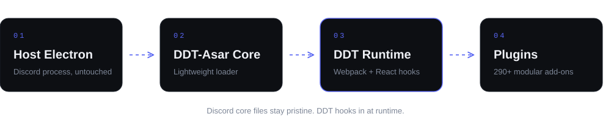
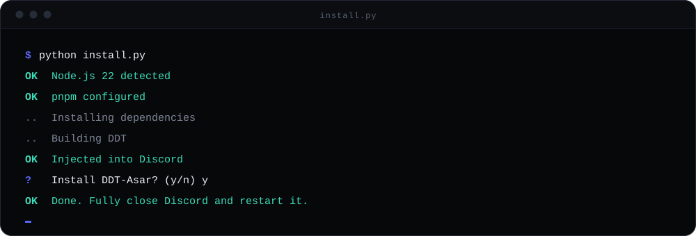
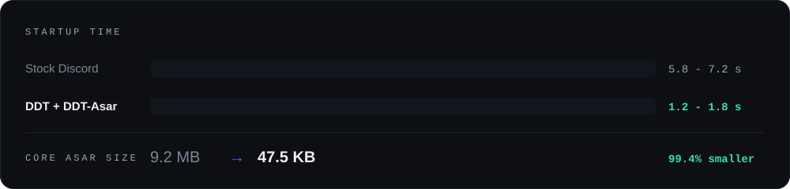
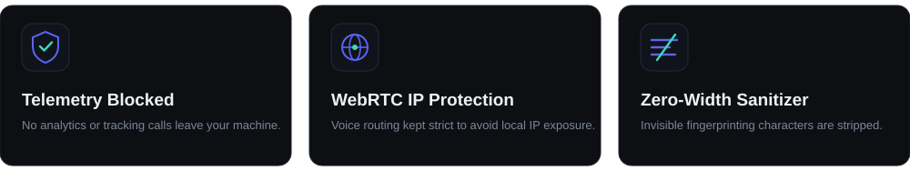
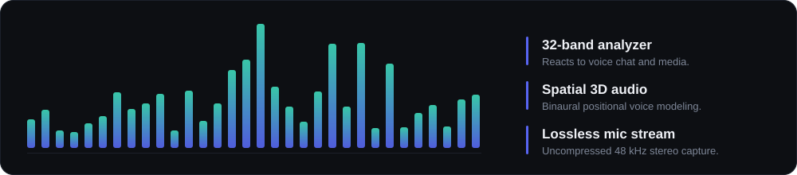
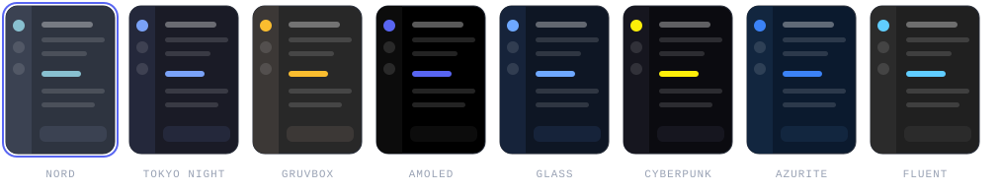
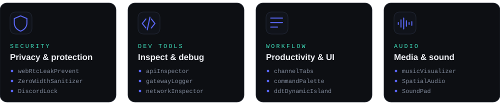

<p align="center">
  
</p>

<p align="center">
  
</p>

<p align="center">
  <a href="https://discord.gg/AVFfV8fXAN"></a>
  <a href="https://github.com/asrarkhann116-ops/DDT-Custom-Client"></a>
  
  
  
  
</p>

<p align="center">
  <a href="#overview"><b>Overview</b></a> &nbsp;/&nbsp;
  <a href="#architecture"><b>Architecture</b></a> &nbsp;/&nbsp;
  <a href="#quick-install"><b>Quick Install</b></a> &nbsp;/&nbsp;
  <a href="#ddt-asar"><b>DDT-Asar</b></a> &nbsp;/&nbsp;
  <a href="#security-and-privacy"><b>Security</b></a> &nbsp;/&nbsp;
  <a href="#audio-and-media"><b>Audio</b></a> &nbsp;/&nbsp;
  <a href="#manual-installation"><b>Manual Install</b></a> &nbsp;/&nbsp;
  <a href="#themes"><b>Themes</b></a> &nbsp;/&nbsp;
  <a href="#highlighted-plugins"><b>Highlights</b></a> &nbsp;/&nbsp;
  <a href="#plugin-directory"><b>Directory</b></a> &nbsp;/&nbsp;
  <a href="#community"><b>Community</b></a>
</p>

<p align="center"></p>

## Overview

**DDT (Discord Developer Tool)** is a high-performance Discord client modification built on top of [Vencord](https://github.com/Vendicated/Vencord). It adds **290+ built-in user plugins**, developer inspection utilities, audio visualizers, privacy shields, a theme loader and a live titlebar status indicator.

<p align="center">
  
</p>

- **Lean:** about 1.1 MB optimized renderer bundle
- **Private:** zero telemetry, 100% local execution
- **Modern:** built for Node.js 22+ and pnpm
- **Smooth:** 50+ hardware-accelerated micro-animations

<p align="center"></p>

## DDT Remastered

DDT Remastered refreshes the look of Discord with **hardware-accelerated micro-animations** across the interface:

<p align="center">
  
</p>

| Area | Behavior | Acceleration |
|:--|:--|:--|
| **Guilds & Servers** | Elastic squircle scale on hover (`cubic-bezier(0.34, 1.56, 0.64, 1)`), press feedback, soft blurple pill glow | GPU-backed |
| **Voice & Audio** | Green speaking aura with multi-stage ripples, floating live-streamer badge | Hardware-accelerated |
| **Messages & Chat** | Subtle message lift on hover with inset blurple marker, highlighted mentions, reply pointer slide | Composited |
| **Reactions & Emojis** | Dock-style zoom on hover (`scale(1.32)`), elastic pop, press squash | Sub-pixel smooth |
| **Modals & Popouts** | 28px frosted backdrop blur, spring entry (`cubic-bezier(0.16, 1, 0.3, 1)`), soft border glow | Native filter blur |
| **System HUDs** | Nitro shimmer, gradient boost progress bars, typing wave, glass settings panels | CSS keyframes |

<p align="center"></p>

## Architecture

DDT uses a modular, isolated injection design that keeps the host Discord Electron process separate from client modifications.

<p align="center">
  
</p>

- **Binary isolation:** Discord core packages stay untouched. DDT hooks into Webpack and React lifecycles at runtime.
- **Fail-safe recovery:** if Discord updates internally, it falls back cleanly without corrupting user profile caches.

<p align="center"></p>

## Quick Install

<p align="center">
  
</p>

> **Requirements:** Windows, Python 3 and Node.js 22+. The installer validates prerequisites and configures pnpm for you.

### Windows one-liner (PowerShell)

```powershell
Remove-Item -Recurse -Force "$env:USERPROFILE\Downloads\DDT-Custom-Client*" -ErrorAction SilentlyContinue; $zip="$env:TEMP\ddt.zip"; (New-Object System.Net.WebClient).DownloadFile("https://github.com/asrarkhann116-ops/DDT-Custom-Client/archive/refs/heads/main.zip", $zip); Expand-Archive -Force $zip "$env:USERPROFILE\Downloads"; Rename-Item "$env:USERPROFILE\Downloads\DDT-Custom-Client-main" "DDT-Custom-Client"; cd "$env:USERPROFILE\Downloads\DDT-Custom-Client"; python install.py
```

### Windows Git clone

```powershell
git clone https://github.com/asrarkhann116-ops/DDT-Custom-Client.git "$env:USERPROFILE\Downloads\DDT-Custom-Client"
cd "$env:USERPROFILE\Downloads\DDT-Custom-Client"
python install.py
```

When the installer finishes, fully close Discord (check the system tray) and start it again.

<p align="center"></p>

## DDT-Asar

During installation you can choose **DDT-Asar**, an optional performance boost.

<p align="center">
  
</p>

| Metric | Stock Discord | DDT + DDT-Asar | Result |
|:--|:--|:--|:--|
| **Startup** | ~5.8 - 7.2 s | **1.2 - 1.8 s** | **~4x faster** |
| **Core asar size** | ~9.2 MB | **~47.5 KB** | **99.4% smaller** |
| **Telemetry** | Enabled by default | **Stripped** | **Zero** |
| **Splash screen** | Default Discord | **DDT animated splash** | **Custom** |
| **Plugin support** | None | **Fully integrated** | **290+ plugins** |

### How it works

DDT-Asar is a custom-branded fork of OpenAsar that replaces Discord's `app.asar` with a lightweight build:

- DDT plugins run normally because injection is isolated from core execution
- A backup (`_app.asar`) is created automatically before replacement
- Fully optional: DDT works on its own without it
- Ships pre-compiled, so no extra build tools are needed

The installer asks **"Install DDT-Asar? (y/n)"**. Type **y** to enable it.

<p align="center"></p>

## Security and Privacy

Privacy is a baseline requirement in DDT, not an optional toggle.

<p align="center">
  
</p>

- **Anti-fingerprinting:** purges zero-width and invisible identifier characters from incoming and outgoing messages.
- **WebRTC IP armor:** keeps voice routing strict to prevent local IP disclosure.
- **Client PIN lock:** optional local passcode to lock Discord while you are away.

<p align="center"></p>

## Audio and Media

Studio-style audio processing and real-time visualizers inside Discord.

<p align="center">
  
</p>

- **Real-time waveform HUD:** 32-band analyzer reacting to voice chat and background media.
- **Spatial 3D audio:** binaural positional modeling for voices.
- **Lossless microphone stream:** uncompressed 48 kHz stereo capture.

<p align="center"></p>

## Manual Installation

```bash
# 1. Clone the repository
git clone https://github.com/asrarkhann116-ops/DDT-Custom-Client.git
cd DDT-Custom-Client

# 2. Install workspace dependencies
pnpm install

# 3. Build DDT
pnpm build

# 4. Inject into Discord
pnpm inject
```

### After a Discord update

When Discord updates into a new version folder (for example `app-1.0.XXXX`), re-link your build with:

```bash
python deploy.py
```

<p align="center"></p>

## Themes

DDT bundles a curated set of ready-to-use themes:

<p align="center">
  
</p>

- **Minimal & clean:** `MinimalCord`, `simplify`, `System24`, `Fluent`, `Discord11`, `Neobrutal`
- **Dark & AMOLED:** `amoled-cord`, `roundmoledV2`, `DarkMatter`, `DarkNeon`, `discorddark`, `nocturnal`
- **Glass:** `FrostedGlass`, `Translucence`, `discord-mica`, `Glass Wave`
- **Gaming & sci-fi:** `cyberpunk2077`, `Fallout4Terminal`, `GGO_Kirito`, `NewAkameGaKill`, `NewRemTheme`, `NieR-Light-Source`
- **Palettes:** `tokyo-night`, `GruvboxSharp`, `Nord`, `Azurite`, `amethyst`, `Material-Discord`

### Applying a theme

1. Open Discord Settings (`Ctrl + ,`).
2. Go to the **Themes** tab in the DDT / Vencord section.
3. Click **Open Themes Folder** and drop in the `.theme.css` files.
4. Enable the theme with its toggle.

<p align="center"></p>

## Highlighted Plugins

DDT ships **290+ user plugins**. Here are standout modules by area.

<p align="center">
  
</p>

### Security, Privacy and Protection

| Plugin | ID | What it does |
|:--|:--|:--|
| **DDT Message Logger** | `ddtMessageLogger` | Keeps deleted and edited messages in local storage with date-range filters |
| **Message Logger Enhanced** | `messageLoggerEnhanced` | Inline badges for edited messages and deleted-message indicators |
| **WebRTC Leak Prevent** | `webRtcLeakPrevent` | Blocks WebRTC IP routing outside proxy tunnels and guards against STUN leaks |
| **Discord Hardened** | `DiscordHardened` | Flags dangerous attachments, deceptive double extensions and hidden Unicode symbols |
| **2FA Hider** | `2FA HIder` | Masks 2FA QR codes, backup codes and verification tokens on screen |
| **Stream Proof** | `StreamProof` | Blanks private DMs, token fields and chosen servers while screensharing |
| **Custom DNS** | `CustomDNS` | Routes Discord API traffic through encrypted resolvers (Cloudflare, Quad9, AdGuard) |
| **Zero-Width Sanitizer** | `ZeroWidthSanitizer` | Strips invisible zero-width characters and tracking tags from received text |
| **Discord Lock** | `DiscordLock` | Client-level PIN or master password lock screen |

### Developer Tools and Inspection

| Plugin | ID | What it does |
|:--|:--|:--|
| **API Inspector** | `apiInspector` | Real-time debugger for Discord REST endpoints, headers and responses |
| **Gateway Logger** | `gatewayLogger` | Live view of raw WebSocket opcodes, heartbeat latency and dispatch events |
| **Event Logger** | `eventLogger` | Captures internal Flux dispatcher events and client lifecycle dispatches |
| **Network Inspector** | `networkInspector` | HTTP traffic monitor with status filtering and duration tracing |
| **DevTools Panel** | `devToolsPanel` | Integrated utility panel with console shortcuts and DOM inspectors |
| **Console Cleaner** | `ConsoleCleaner` | Configurable log-level filter to cut console noise and memory bloat |
| **Client Diagnostics** | `ClientDiagnostics` | Live profiler for CPU spikes, memory leaks, heap growth and handlers |
| **Element Highlighter** | `elementHighlighter.dev` | UI boundary inspector with direct React fiber props view |

### Productivity and Interface

| Plugin | ID | What it does |
|:--|:--|:--|
| **DDT Dynamic Island** | `ddtDynamicIsland` | Floating status pill for track updates, notifications and call status |
| **Channel Tabs** | `channelTabs` | Browser-style persistent tabs for channels, servers and DMs |
| **Multi-Instance** | `MultiInstance` | Run multiple Discord sessions side by side |
| **Better Screenshare** | `betterScreenshare.desktop` | Higher-resolution screenshare presets up to 4K at 60 FPS |
| **Limitless Screenshare** | `limitlessScreenshare` | Custom bitrate and frame pacing controls |
| **Command Palette** | `commandPalette` | Spotlight-style search (`Ctrl + Shift + P`) for actions, channels and plugins |
| **Collapsible UI** | `collapsibleUi` | Collapsible sidebar, member list and channel panels for a compact layout |

### Audio, Media and Aesthetics

| Plugin | ID | What it does |
|:--|:--|:--|
| **Music Visualizer** | `musicVisualizer` | Real-time waveform HUD behind chat or voice panels with synced lyrics |
| **Spatial Audio** | `SpatialAudio` | 3D binaural voice positioning with custom distance curves |
| **Stereo Microphone & Audio** | `stereoScreenshareAudio`, `betterMicrophone.desktop` | Uncompressed stereo capture for mic input and screenshare audio |
| **SoundPad** | `SoundPad` | In-app hotkey soundboard routed into voice channels, no virtual cable needed |
| **DDT Spotify Lyrics Status** | `ddtSpotifyLyricsStatus` | Syncs Spotify playback and live lyrics into your status |
| **Fast GIF Picker** | `FastGifPicker` | Lightweight GIF previews to remove lag spikes |
| **DDT Theme Manager** | `developerTheme` | Quick-picker GUI to preview, activate and hot-reload local CSS themes |

<p align="center"></p>

## Plugin Directory

<details>
<summary><b>Click to expand a categorized selection of the bundled plugins</b></summary>

**# & A**

`2FA HIder` • `advancedPermissions` • `altKrispSwitch` • `alwaysExpandProfiles` • `animalese` • `apiInspector` • `atSomeone` • `autoJumpToMessage` • `autoZipper`

**B**

`BadgesSelector` • `BoosterCount-main` • `bannersEverywhere` • `baseDecoder` • `betterActivities` • `betterAudioPlayer` • `betterBanReasons` • `betterBlockedUsers` • `betterCommands` • `betterForwards` • `betterImageEditor` • `betterInvites` • `betterMicrophone.desktop` • `betterPlusReacts` • `betterScreenshare.desktop` • `blockKeywords` • `blockKrisp`

**C**

`ClientDiagnostics` • `ConsoleCleaner` • `CustomDNS` • `channelBadges` • `channelTabs` • `clanSwitcher` • `cleanChannelName` • `cleanerChannelGroups` • `clickableRoles` • `clientSideBlock` • `clipUpload.desktop` • `clipsEnhancements.discordDesktop` • `collapsibleUi` • `commandPalette` • `contentWarning` • `copyProfileColors` • `copyStatusUrls` • `copyUserMention` • `crashHandlerEnhanched` • `cursorBuddy` • `customFolderIcons` • `customSounds` • `customStatusTimeouts` • `customStream` • `customTimestamps` • `customUserColors` • `customWelcomer`

**D**

`DiscordHardened` • `DiscordLock` • `ddtAnnouncements` • `ddtChatStats` • `ddtDynamicIsland` • `ddtEasterEgg` • `ddtMessageLogger` • `ddtMessageScheduler` • `ddtSpotifyLyricsStatus` • `ddtTutorial` • `ddtUpdater` • `declutter` • `detectBlock` • `devToolsPanel` • `developerTheme` • `disableAnimations` • `disableCameras` • `discordDevBanner` • `dontLimitMe` • `downloadAllAttachments` • `dragFavoriteEmotes` • `dragify`

**E**

`elementHighlighter.dev` • `embeddedURLs` • `equibopStreamFixes.equibop` • `equicordHelper` • `equicordToolbox` • `equissant` • `eventLogger` • `exitSounds` • `expandedWidgets` • `exportMessages`

**F**

`FastGifPicker` • `FloeP2PService.desktop` • `FollowUser` • `fastDeleteChannels` • `favouriteAnything` • `fileUpload` • `findReply` • `fixFileExtensions` • `followVoiceUser` • `fontLoader` • `frequentQuickSwitcher` • `friendCodes` • `friendTags` • `friendshipRanks` • `fullVcPfp`

**G**

`gatewayLogger` • `ghosted` • `gifCollections` • `gifMaker` • `githubRepos` • `globalBadges` • `googleThat`

**H & I**

`Hisako's Optimizations` • `hideChatButtons` • `hideMessages` • `hideServers` • `homeTyping` • `hopOn` • `husk` • `IGP` • `iRememberYou` • `iconViewer` • `idleAutoRestart` • `ignoreCalls` • `inRole` • `ingtoninator` • `instantScreenshare` • `invisibleChat.desktop` • `inviteDefaults`

**J, K & L**

`jumpTo` • `keyboardNavigation` • `keyboardSounds` • `keywordNotify` • `lastActive` • `limitlessScreenshare` • `loginWithQR`

**M**

`MultiInstance` • `markdownTables` • `mediaPlaybackSpeed` • `messageBurst` • `messageColors` • `messageFetchTimer` • `messageLinkTooltip` • `messageLoggerEnhanced` • `messageNotifier` • `messagePeek` • `messageTranslate` • `micLoopbackTester` • `middleClickTweaks` • `moreCommands` • `moreStickers` • `moreUserTags` • `moyai` • `musicControls` • `musicVisualizer`

**N & O**

`NightcordPort` • `networkInspector` • `neverPausePreviews` • `newPluginsManager` • `noNitroUpsell` • `noPushToTalk` • `noRPC.discordDesktop` • `noRoleHeaders` • `normalizeMessageLinks` • `notificationTitle.discordDesktop` • `opSec` • `openOptimizer` • `orbolayBridge`

**P & Q**

`PluginStars` • `PrivateSearchEngine.desktop` • `partyMode` • `pendingFriendRequest` • `philsPluginLibrary` • `pinIcon` • `pingNotifications` • `polishWording` • `presenceLab` • `profileSets` • `quickThemeSwitcher.discordDesktop` • `quoter`

**R**

`RamOptimizer.desktop` • `randomVoice` • `reactionTimestamps` • `recentDMSwitcher` • `remix` • `repeatMessages` • `replyPingControl` • `richMagnetLinks` • `richPresence` • `rpcEditor`

**S**

`ScreenShareAlert` • `SecureBookmarks` • `SecureZipper` • `Securecord` • `SecurecordOpossum` • `ServerBadges` • `SoundPad` • `SpatialAudio` • `StreamProof` • `saveFavoriteGIFs` • `scamLinkDetector` • `scheduledMessages` • `screenRecorder.equibop` • `searchFix` • `sedEnhanced` • `sekaiStickers` • `sendTrail` • `serverSearch` • `shareClientConfig` • `showBadgesInChat` • `showMessageEmbeds` • `showResourceChannels` • `showRolesInChat` • `showSongName` • `sidebarChat` • `signature` • `silenceUsers` • `snowfall` • `songLink.desktop` • `songSpotlight.desktop` • `splitLargeMessages` • `statusCycler` • `statusPresets` • `statusWhileActive.desktop` • `steamStatusSync` • `stereoInstaller.desktop` • `stereoScreenshareAudio` • `stickerBlocker` • `stopAutoUnread` • `streaks` • `streamingCodecDisabler`

**T**

`talkInReverse` • `themeLibrary` • `tidalEmbeds` • `timezones` • `title` • `toastNotifications` • `toggleVideoBind` • `toneIndicators` • `translatePlus` • `triviaAI` • `typingFriends`

**U & V**

`unitConverter` • `universalMention` • `unreadBadgeCount` • `urlHighlighter` • `userpfp` • `userpluginInstaller.dev` • `vcPanelSettings` • `vencord-gpubinder-main` • `voiceButtons` • `voiceChannelLog` • `voiceChatUtils` • `voiceJoinMessages` • `voiceMessageTranscriber.desktop` • `voiceMessagesInBackground` • `voiceRejoin` • `voiceServerInfo` • `voiceStats`

**W - Z**

`waitForSlot` • `webRtcLeakPrevent` • `webpackTarball` • `whitelistedEmojis` • `whosWatching` • `wigglyText` • `writeUpperCase` • `yMusicSync.desktop` • `ZeroWidthSanitizer` • `zipPreview`

</details>

<p align="center"></p>

## Troubleshooting and FAQ

**Discord updated and DDT disappeared. How do I restore it?**

Discord creates a new version folder (such as `app-1.0.XXXX`) on update. Run:

```bash
python deploy.py
```

It finds the new folder and links DDT again without a rebuild.

**Can I use DDT on Discord PTB or Canary?**
Yes. In `scripts/runInstaller.mjs`, or when running `pnpm inject`, pick your target release channel.

**How do I uninstall DDT?**

```bash
pnpm uninject
```

If DDT-Asar was installed, restore the backup `_app.asar` to `app.asar` inside your Discord `resources/` folder.

**Are credentials or tokens collected?**
No. DDT has a strict zero-telemetry policy. Everything runs on your local machine with no external logging.

<p align="center"></p>

## Community

- **Discord:** [discord.gg/AVFfV8fXAN](https://discord.gg/AVFfV8fXAN)
- **Issues:** [GitHub Issues](https://github.com/asrarkhann116-ops/DDT-Custom-Client/issues)
- **Source:** [DDT on GitHub](https://github.com/asrarkhann116-ops/DDT-Custom-Client)

## Disclaimer

DDT is a third-party client modification and is not affiliated with or endorsed by Discord Inc. Modifying the Discord client may go against Discord's Terms of Service. Which plugins you enable and how you use them is entirely your own decision and responsibility, and the developers accept no liability for how the software is used. Use it at your own risk.

## License and Attribution

Released under the **GNU General Public License v3.0 (GPL-3.0)**.

- **Developer:** [Asrar Khan](https://github.com/asrarkhann116-ops) (DDT Development Team)
- **Upstream:** built on [Vencord](https://github.com/Vendicated/Vencord) and [OpenAsar](https://github.com/GooseMod/OpenAsar)
- **Attribution:** full copyright, derivative-work licensing and plugin attribution are in the [LICENSE](LICENSE) file.

<p align="center">
  
</p>
